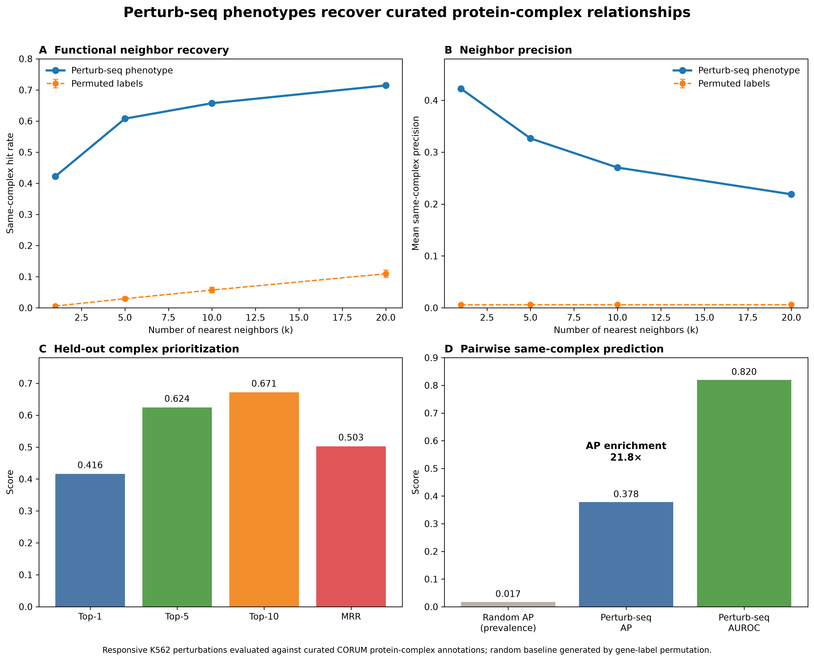
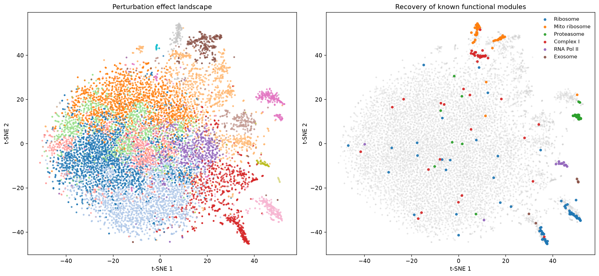
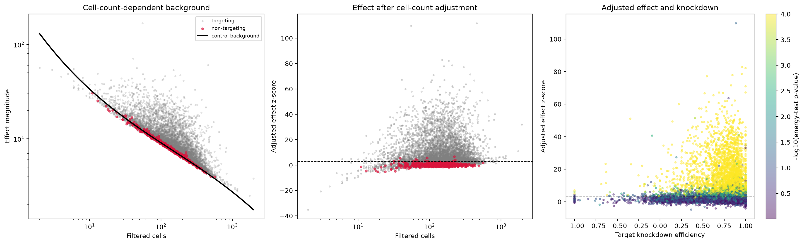
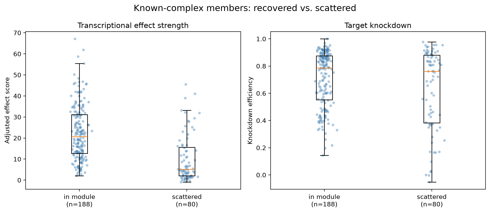
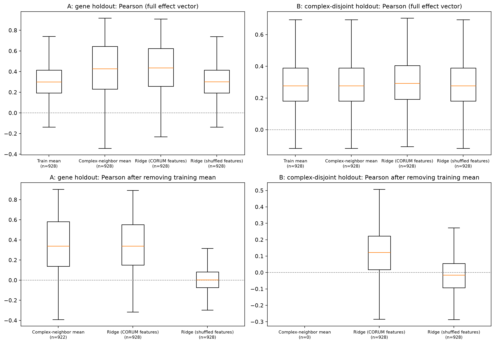
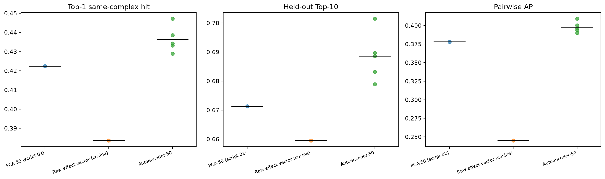

# Genome-scale Perturb-seq Effect Atlas

A reproducible computational framework for modeling CRISPR perturbation effects, identifying functional gene modules, and benchmarking phenotype-based functional prioritization and held-out response prediction from genome-scale Perturb-seq data.

**Project focus:** Perturb-seq · CRISPR screens · single-cell genomics · perturbation modeling · functional genomics · network analysis · dimensionality reduction · protein complexes · benchmarking · reproducible bioinformatics

This project analyzes the K562 genome-scale CRISPRi Perturb-seq dataset from Replogle et al. to quantify transcriptional perturbation effects and ask a practical functional-genomics question:

> **Can transcriptome-wide perturbation phenotypes recover known gene-function relationships, prioritize held-out CORUM complex annotations, and help predict the response of withheld genes?**

The workflow combines perturbation-aware quality control, technical-confounder correction, dimensionality reduction, cosine-similarity networks, Leiden clustering, independent validation against curated CORUM protein complexes, a held-out response-prediction benchmark, and a comparison of linear (PCA) and nonlinear (autoencoder) representations.

---

## Key results

- Processed **11,258 perturbation profiles**; initial QC catalogued approximately **9,867 unique target identifiers**. This is not a count of successfully modeled genes: some identifiers could not be parsed, and downstream analyses apply additional eligibility filters.
- Identified a strong dependency between naïve transcriptome-wide effect magnitude and perturbation cell count (Spearman ρ = -0.860), and corrected it using non-targeting controls (ρ = 0.038 after adjustment).
- Recovered coherent functional modules including ribosome, mitochondrial ribosome, proteasome, RNA polymerase II, respiratory complex I, and RNA exosome perturbations.
- Constructed gene-level perturbation embeddings for **2,670 responsive genes**, of which **928** have curated CORUM annotations across **491 retained CORUM complexes**.
- **Functional neighbor recovery.** A same-complex gene was the top-ranked neighbor for **42.2%** of query genes (0.58% under 100 gene-label permutations), and appeared within the top 5 / 10 / 20 neighbors for **60.8% / 65.7% / 71.4%**.
- **Held-out complex prioritization.** Top-1 / Top-5 / Top-10 accuracy of **41.6% / 62.4% / 67.1%**, MRR **0.50**.
- **Pairwise same-complex prediction.** AUROC **0.820**, average precision **0.378** at 1.73% positive prevalence (**21.8×** over prevalence).
- **Held-out response prediction.** Using only CORUM membership as features, predicted responses of withheld genes had Pearson correlation **0.433** (ridge) versus **0.299** for a training-mean baseline (paired difference +0.134, 95% CI 0.124 to 0.144). No gene-specific generalization was found when all complexes of a test gene were withheld.
- **Representation comparison.** A 50-dimensional denoising autoencoder was comparable to slightly better than 50-dimensional PCA on the CORUM benchmark (pairwise AP +0.020, 95% CI 0.010 to 0.030); several other metrics were not distinguishable from PCA.
- 40 unit tests and a CI workflow cover the benchmark, split, bootstrap and adjustment logic.

The held-out complex benchmark ranks CORUM annotations by similarity-weighted votes from phenotype neighbors. The query's CORUM annotation is used to score the ranking, not to generate it. This is a held-out complex-prioritization benchmark, not a claim of de novo or unknown gene-function discovery.

---

## Benchmark summary



Perturbation-effect similarity substantially outperformed permuted gene labels for recovery of curated protein-complex relationships.

The pairwise benchmark is highly imbalanced, with only 1.73% positive gene pairs. For this reason, average precision is emphasized alongside AUROC. The observed AP of 0.378 corresponds to approximately **21.8-fold enrichment over positive prevalence**.

The held-out complex-prioritization benchmark withholds each query's CORUM annotation from the neighbor vote and evaluates the ranked complexes against that annotation. Since the candidate labels come from curated, annotated neighbors, this evaluates recovery and prioritization of known complex membership; it does not establish function for genes with no known annotation.

---

## Biological effect landscape



Genome-scale perturbation phenotypes form structured neighborhoods in transcriptional-effect space. Known functional gene groups occupy distinct regions of the embedding, including cytosolic ribosome, mitochondrial ribosome, proteasome, respiratory complex I, RNA polymerase II and RNA exosome.

These gene-name groups are used as biological sanity checks. Formal benchmarking is performed independently using curated CORUM protein-complex annotations. Many weakly responsive perturbations occupy a central region that Leiden clustering splits into large, mostly non-functional clusters, so the cluster count is not reported as a number of functional modules.

---

## Why perturbation-effect QC matters

A naïve transcriptome-wide effect score (L2 norm of the effect vector) showed a strong dependency on the number of cells contributing to each perturbation profile:

**Spearman ρ = -0.860**

Non-targeting controls followed the same curve, so raw effect magnitude could not be interpreted directly as biological perturbation strength. I modeled the non-targeting-control background as a smooth function of cell count and computed a cell-count-adjusted effect score. After adjustment:

**Spearman ρ = 0.038**



This prevents low-cell-count perturbations from being systematically prioritized simply because their estimated profiles are noisier. The adjusted score is a descriptive perturbation-strength metric rather than an inferential statistical z-score; a large fraction of targeting perturbations exceed a score of 3, so it is not used as a significance threshold.

---

## Strong transcriptional effects improve functional recovery

Known-complex perturbations that were recovered within coherent transcriptional neighborhoods had substantially larger adjusted effects than members that remained scattered.



Median adjusted effect score:

- recovered / in-module members: **20.74**
- scattered members: **5.11**
- Mann–Whitney P = **3.4 × 10⁻¹⁴**

The corresponding groups did not differ comparably in target knockdown efficiency or in the number of cells contributing to the profile. Within this benchmark, recovery of known functional relationships is therefore associated with the strength of the measured transcriptional phenotype rather than greater cell coverage or detectably stronger target knockdown.

---

## Analysis workflow

```text
Replogle et al. genome-scale Perturb-seq
                    │
                    ▼
          Perturbation-level QC
                    │
                    ▼
      Detect technical confounding
                    │
                    ▼
 Non-targeting-control background model
                    │
                    ▼
  Cell-count-adjusted effect strength
                    │
                    ▼
     PCA / autoencoder representation
                    │
                    ▼
        Cosine similarity / kNN
                    │
        ┌───────────┼────────────┐
        ▼           ▼            ▼
 Leiden modules  Gene neighbors  CORUM-feature
        │           │            response model
        ▼           ▼            │
  Known-complex  Held-out        ▼
    recovery     complex      Held-out response
                 prioritization   prediction
        └───────────┬────────────┘
                    ▼
             CORUM benchmark
```

---

## Data

The analysis uses the genome-scale K562 CRISPRi Perturb-seq resource from Replogle et al. (see References). It starts from the processed genome-wide K562 bulk perturbation matrices rather than reprocessing raw sequencing reads:

```text
11,258 perturbation profiles × 8,248 measured genes
```

The normalized matrix contained non-finite values affecting 73 genes. These genes were excluded from downstream analysis rather than imputed as zero. Perturbation-level metadata (filtered cell number, target-expression fold change, leverage score, energy-test P value and others) are provided with the matrices. Energy-test P values are reported with a floor of 1e-4, so they are not used to rank perturbations against one another.

CORUM annotations are the Human core set. Complexes were retained if they had 3 to 50 members and at least 3 members represented in the responsive Perturb-seq set (491 complexes, 928 annotated genes).

Large source matrices are not stored in this repository.

---

## Methods

### Perturbation embedding

Each perturbation is represented by its transcriptome-wide response. Responsive perturbations used for the functional benchmarks satisfy:

```text
adjusted effect score >= 5
energy-test P <= 0.001
QC pass (>= 25 filtered cells)
```

These thresholds define the analysis subset and are analysis choices, not genome-wide statistical significance thresholds. Multiple promoter-specific perturbations of the same gene are collapsed to one median embedding so that P1/P2 perturbations of one gene cannot appear as each other's functional neighbors.

### Network and modules

A cosine k-nearest-neighbor graph is built on the PCA embedding and partitioned with Leiden clustering. A resolution sweep (0.5 to 8) on the responsive-only graph showed that mean family recovery plateaued above resolution 4 (mean best F1 0.504 at 4, 0.516 at 8), so I did not tune further. Module analysis is exploratory; CORUM provides the independent quantitative benchmark.

### CORUM benchmark

CORUM annotations are not used to construct the embeddings or neighbor graph.

- **Nearest-neighbor recovery:** a neighbor is a hit if it shares at least one retained CORUM complex with the query.
- **Held-out complex prioritization:** neighbors vote for their complexes, weighted by cosine similarity; the query's own annotation is used only for scoring. Ties between equally supported complexes are broken by complex ID so results are reproducible.
- **Pairwise benchmark:** cosine similarity is evaluated as a classifier of shared-complex membership (7,460 positive and 422,668 sampled negative pairs).
- **Permutation baseline:** gene identities are permuted across fixed embeddings (100 permutations).

| Metric | Score |
|---|---:|
| Top-1 accuracy | 0.416 |
| Top-5 accuracy | 0.624 |
| Top-10 accuracy | 0.671 |
| MRR | 0.50 |
| Pairwise AP (prevalence 0.0173) | 0.378 |
| Pairwise AUROC | 0.820 |

| k | Perturb-seq hit rate | Permuted baseline (mean ± SD) |
|---:|---:|---:|
| 1 | 0.422 | 0.0058 ± 0.0026 |
| 5 | 0.608 | 0.0294 ± 0.0061 |
| 10 | 0.657 | 0.0571 ± 0.0090 |
| 20 | 0.714 | 0.1095 ± 0.0115 |

---

## Held-out perturbation-response prediction



In the bottom-right panel, the ridge correlation (about 0.12) arises because all test genes receive the same constant offset vector; it is not gene-specific.

Using only curated CORUM complex membership as features (no phenotype of the held-out gene), I predicted the transcriptome-wide response (8,175 genes) of withheld genes in 5-fold cross-validation over 928 annotated genes. Models were a training-mean baseline, a Jaccard-weighted complex-neighbor average, ridge regression (regularization chosen by cross-validation within the training set), and ridge with row-shuffled features as a negative control.

**Gene holdout.** Both models outperformed the training-mean baseline:

| Method | Pearson | Difference vs. mean (95% bootstrap CI) | Genes improved | Top-100 gene overlap |
|---|---:|---|---:|---:|
| Training mean | 0.299 | n/a | n/a | 0.172 |
| Complex-neighbor mean | 0.423 | +0.124 (0.111 to 0.137) | 70% | 0.349 |
| Ridge (CORUM features) | 0.433 | +0.134 (0.124 to 0.144) | 76% | 0.336 |
| Ridge (shuffled features) | 0.299 | 0.000 (-0.0001 to 0.0002) | 51% | 0.171 |

Correlation after removing the training mean was 0.352 for neighbor averaging and 0.347 for ridge, indicating signal beyond the shared stress response. The two models were not compared against each other. Prediction was more accurate for genes with stronger transcriptional effects (ridge Pearson 0.25, 0.44 and 0.61 across effect-strength tertiles). Absolute gain over the baseline also rose with effect strength, but the ratio to the baseline was similar across tertiles (about 1.3 to 1.4), consistent with higher signal-to-noise for strong perturbations rather than evidence that the model learns more for them.

**Complex-disjoint holdout.** When no member of a test gene's complexes was present in training, neighbor averaging reduced exactly to the training mean. Ridge showed a small Pearson gain (+0.013) but almost no gain in top-100 overlap (+0.003), and improved only 49% of genes. In a 3-fold check, its predictions were a single constant vector across test genes (standard deviation about 1e-6), so I do not interpret this as gene-specific generalization.

This model performs imputation within known complexes. It does not generalize to functional modules without known members, and it is not a virtual-cell model.

---

## Linear versus nonlinear representation



I replaced the 50-dimensional PCA embedding with a 50-dimensional denoising autoencoder (PyTorch), trained without CORUM labels on the same QC-passing perturbations, and re-ran the identical CORUM evaluation on the same 2,670 genes. Hyperparameters were not tuned on the benchmark. Early stopping used reconstruction error on a held-out 10% of perturbations.

| Representation | Top-1 hit | Top-20 hit | Held-out Top-10 | Pairwise AP | Pairwise AUROC |
|---|---:|---:|---:|---:|---:|
| Autoencoder-50 (5 seeds, mean ± SD) | 0.436 ± 0.007 | 0.729 ± 0.006 | 0.688 ± 0.009 | 0.398 ± 0.007 | 0.830 ± 0.004 |
| PCA-50 (single run) | 0.422 | 0.714 | 0.671 | 0.378 | 0.820 |
| Raw effect vector, cosine | 0.384 | 0.708 | 0.660 | 0.245 | 0.802 |

In a paired gene-level bootstrap (500 draws; autoencoder averaged over seeds minus PCA), the 95% interval excluded zero for pairwise AP (+0.020; 0.010 to 0.030), held-out Top-10 (+0.017; 0.005 to 0.029), Top-20 hit rate (+0.014; 0.003 to 0.026) and held-out MRR (+0.012; 0.002 to 0.021), but included zero for Top-1 hit rate (+0.014; -0.002 to 0.030) and held-out Top-1 (+0.008; -0.006 to 0.021). Every individual seed was above PCA on Top-1 hit rate and pairwise AP.

These intervals treat genes as independent although genes in the same complex are correlated, and metrics were not corrected for multiple comparisons, so the intervals are likely too narrow. I interpret the result as comparable to slightly better than PCA, not as a clear improvement. Cosine similarity on the raw effect vector was lower (pairwise AP 0.245).

---

## Repository structure

```text
perturbseq-effect-atlas/
├── data/
│   ├── raw/                 # downloaded matrices, not tracked
│   ├── processed/           # derived matrices, not tracked
│   └── reference/           # CORUM table
├── results/
│   ├── figures/
│   └── tables/
├── scripts/
│   ├── 01_qc.py
│   ├── 02_effect_matrix.py
│   ├── 03_adjust_effect_score.py
│   ├── 04_network.py
│   ├── 05_module_diagnostics.py
│   ├── 06_corum_benchmark.py
│   ├── 07_make_portfolio_figures.py
│   ├── 08_heldout_perturbation_prediction.py
│   ├── 09_autoencoder_benchmark.py
│   └── 10_paired_bootstrap.py
├── tests/
├── .github/workflows/ci.yml
├── pyproject.toml
├── Makefile
└── README.md
```

---

## Reproduce the analysis

### 1. Environment

```bash
conda create -n perturbseq python=3.11 -y
conda activate perturbseq
pip install -e ".[dev,deep,network]"
```

### 2. Data

Download the K562 genome-wide matrices from the Replogle et al. resource (https://gwps.wi.mit.edu/) and place them in `data/raw/`:

```text
K562_gwps_raw_bulk_01.h5ad
K562_gwps_normalized_bulk_01.h5ad
```

The CORUM Human core table is stored at `data/reference/corum_human_core.csv` (retrieved with `BioPlex::getCorum(set = "core", organism = "Human")`).

### 3. Run

```bash
python scripts/01_qc.py
python scripts/02_effect_matrix.py
python scripts/03_adjust_effect_score.py
python scripts/04_network.py
python scripts/05_module_diagnostics.py
python scripts/06_corum_benchmark.py --n-permutations 100
python scripts/08_heldout_perturbation_prediction.py
python scripts/09_autoencoder_benchmark.py
python scripts/10_paired_bootstrap.py
python scripts/07_make_portfolio_figures.py
```

### 4. Test

```bash
make test    # pytest
make lint    # ruff: syntax errors and undefined names only
```

The unit tests use small synthetic datasets, so they run without the source matrices. Several tests deliberately fail if a known safeguard is removed, such as the complex-disjoint split leaking shared complexes, the cell-count adjustment being dropped, or tie-breaking depending on Python hash order.

---

## Main outputs

**Figures:** `results/figures/01_*.png` through `09_autoencoder_vs_pca.png`

**Benchmark tables** (`results/tables/`):

```text
corum_benchmark_comparison.csv
corum_complex_prediction_summary.csv
corum_pairwise_metrics.csv
corum_query_metrics.csv
corum_complexes_retained.csv
heldout_prediction_summary.csv
heldout_prediction_vs_mean.csv
heldout_prediction_per_gene.csv
autoencoder_vs_pca_summary.csv
autoencoder_minus_pca_bootstrap.csv
```

---

## Design principles

- **Perturbation-aware QC.** Target knockdown, perturbation coverage, non-targeting controls and phenotype strength are considered separately from generic transcriptomic QC.
- **Explicit confounder modeling.** A strong cell-count dependency was identified before ranking perturbations.
- **Leakage-aware evaluation.** Promoter-level perturbations of one gene are collapsed; CORUM labels never enter embedding construction; the complex-disjoint split removes every training gene that shares any complex with a test gene; a shuffled-feature control checks for leakage.
- **Baselines and uncertainty.** Every model is compared with a simple baseline, and differences are reported with bootstrap intervals or seed variability.
- **Metrics suited to class imbalance.** Average precision is reported alongside AUROC.
- **Negative results are reported.** Complex-disjoint prediction and several autoencoder-versus-PCA comparisons did not show gene-specific or clear gains, and are described as such.

---

## Limitations

- The approximately 9,867 initial QC target identifiers are not the number of successfully parsed or modeled genes; the reported gene-level embeddings include **2,670 responsive genes**, and the CORUM benchmarks use **928** annotated genes.
- The CORUM benchmark evaluates recovery of curated protein-complex relationships. It does not test discovery of unknown gene functions. CORUM complexes overlap, so complex-level Top-k metrics may be somewhat optimistic.
- Results are restricted to perturbations with a measurable transcriptional response; weak perturbations are hard to place in functional neighborhoods.
- The adjusted effect score is descriptive, not an inferential statistical z-score, and the responsiveness thresholds are analysis choices.
- The response-prediction model uses only complex membership. It imputes within known complexes and does not generalize to unseen modules.
- Bootstrap intervals resample genes independently, ignoring correlation within complexes, and are probably too narrow. PCA was evaluated once while the autoencoder was averaged over 5 seeds.
- The analysis uses processed perturbation-level profiles rather than single-cell reads, and a single K562 CRISPRi dataset. Other cell types (for example the RPE1 data from the same study), doses, time points and drug perturbations are not covered.

---

## References

If you use the underlying Perturb-seq dataset, please cite:

Replogle JM, Saunders RA, Pogson AN, et al. Mapping information-rich genotype-phenotype landscapes with genome-scale Perturb-seq. *Cell*. 2022;185(14):2559–2575.e28. [doi:10.1016/j.cell.2022.05.013](https://doi.org/10.1016/j.cell.2022.05.013)

For CORUM annotations, cite:

Tsitsiridis G, Steinkamp R, Giurgiu M, et al. CORUM: the comprehensive resource of mammalian protein complexes—2022. *Nucleic Acids Research*. 2023;51(D1):D539–D545. [doi:10.1093/nar/gkac1015](https://doi.org/10.1093/nar/gkac1015)
